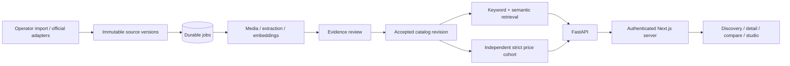

# Approved technical blueprint

This durable implementation brief records the user's approved 23 October 2026 plan. PRODUCT.md owns product truth; TRACEABILITY.md records actual implementation status. Targets below are not measured results.

## Scope and architecture

BouquetBrowse is a Vietnamese-first, English-supported, mobile-first private research pilot for Hanoi and VND. Discover across sellers, filter bouquets, inspect provenance, see visual alternatives, compare qualified advertised prices, then open the original seller's post. Checkout, inventory guarantees, customer photo upload, seller claims, learned ranking and fine-tuning are deferred.

Use a Next.js App Router frontend, thin authenticated server proxy, FastAPI modular monolith, Python worker, PostgreSQL 17 with pgvector, Supabase Auth/private Storage, and optional bounded OpenAI extraction/text embeddings plus frozen SigLIP 2 image embeddings. One worker, PostgreSQL jobs and scheduled inserts; no Redis, Celery, GPU service, Kubernetes or analytics warehouse initially. Local SQLite is a clearly bounded development fallback, not the production database.

## Data and evidence

One listing is one seller's identifiable bouquet configuration. Never share canonical listing ownership across sellers. Material composition/count/arrangement changes create distinct configurations; price changes create observations. Exact platform IDs deduplicate posts, immutable relevant-content hashes deduplicate revisions, versioned job keys deduplicate effects. Reused photos alone do not merge products.

Keep sellers/accounts/posts/post versions/media, listing associations/revisions, extraction runs/field assertions, commercial observations, model versions/vectors, cohort snapshots/members, leased jobs/cursors, review actions/takedowns, app users, costs and minimal operational counters separately addressable. UUID identifiers; string platform IDs; UTC timestamps; integer money and explicit currency. Hanoi-local interpretation is required for seller-relative dates. Unknown is null, not a guessed fact.

Each extracted field records value, stated/visual/context/unknown/conflict status, source evidence, uncalibrated score, null calibrated confidence until validation, review state and method version. Commercial facts require caption/structured/human evidence. No photographed-price inference, exact visual stem counting, image-based freshness/quality scores, or inferred inventory. Captions and model outputs are untrusted. Structured shape alone does not establish grounding.

## Acquisition and processing

Use capability-gated official Threads keyword search and Instagram professional business discovery. Actual scopes, fields, quotas and Hanoi coverage must be experimentally verified. Submitted URLs are references, not promises of fetchability. No broad scraping, access-control bypass, anti-bot bypass or silent demo fallback. Operator imports remain usable independently of platform approval. Record content-use/acquisition context; do not put real datasets or private media in this public repository.

Validate identity, URLs, payloads and permitted media; create changed source revisions; enqueue enrichment; extract grounded claims; associate configurations; review commercial ambiguity; publish accepted snapshots transactionally. At-least-once jobs use leases, short SKIP LOCKED claims on PostgreSQL, bounded retries/Retry-After, visible failures and explicit replay. External calls occur outside short claim transactions. Discovery defaults to six-hour intervals, daily Instagram refresh, application ceilings of 100 discovery/200 refresh requests per day, always subject to lower provider limits.

Rules handle Vietnamese/English prices (`650k`, `650.000đ`, `1tr2`), ranges/from/promotions, delivery/deposit separation, stated counts and lead time. Bare `650` never becomes 650,000. Preserve caption evidence and currency inference provenance. Multi-product associations require review. Model calls use strict schema, no tools, store=false, bounded image count/tokens/retries and cost reservations. SigLIP loads only in an explicitly configured optional worker environment with an exact revision.

## Retrieval and price qualification

Keyword/semantic search fuses ranks; filters and stable cursor tie-breaking apply explicitly. Similarity uses configuration, image, semantic and presentation evidence; missing modalities reduce evidence rather than gaining weight through renormalization. Fixture vectors are explicitly separate demo providers, never a substitute for real inference.

Strict benchmark: Hanoi/VND, matching arrangement/primary flower/color, compatible composition, reviewed stated comparable size within ±20%, reviewed exact bouquet price, applicable validity or a 30-day advertisement window. Exclude deposits/delivery, ranges/from, uncertain currency, unresolved product-price association and expired promotions. Old posts re-observed today are still old advertisements.

Build from the full eligible relational pool, exclude the selected seller, choose one nearest configuration per other seller without consulting its price. Never use a browsing budget or target-price range to build the cohort. Fewer than five other sellers: cards only. Five–nine: median/range, limited-sample label. Ten or more: quartiles and tied midrank percentile. Relative difference is (selected−median)/median. No representative-market, inflation, sales or seasonal conclusions from changing/sparse samples. Show independent seller count, window and exclusions.

## Experience and API

MVP routes: /, /search, /bouquets/[id], /compare (up to four), /sellers/[id], /analytics and /admin. Photo-forward botanical interface, accessible Vietnamese typography, two mobile columns, persistent comparison selection, URL search state, visible focus and reduced motion. Show loading/empty/error/unknown-price/stale/source-unavailable/insufficient-comparison states. Label advertised price, posted time, last check, extraction review and availability ask-seller distinctly. Demo labels remain visible on cards and charts.

Versioned authenticated REST serves catalog/facets/detail/similar/comparison/history/seller/analytics and admin import/source/sync/jobs/retry/review/reprocess/takedown. Request IDs, structured errors, explicit capability errors, bounded page sizes and idempotency keys. Public health checks disclose no data. Supabase JWT issuer/audience/expiry/signature plus DB membership authorize the private pilot; tester/reviewer/admin roles gate server actions.

## Delivery and quality targets

M0 is the complete demo-backed thin application. M1 verifies platform access; M2 hardens live ingestion; M3 validates extraction; M4 measures real visual search; M5 entity resolution; M6 UX completion; M7 cohorts/history; M8 private operations; M9 pilot evaluation. Later branch names: codex/01-source-feasibility, 02-ingestion, 03-extraction, 04-visual-search, 05-pilot-validation, 06-private-deployment. Every module branches from merged main, implements/tests, pushes, opens and attaches a PR, then agent-driven squash-merges only passing current-head checks. No repeated approval needed; respect protections.

Pilot coverage targets: 100 recent relevant listings, ten sellers, 50 unambiguous prices, two reference configurations with five other comparable sellers. Evaluation starts with 200 permitted posts/12 sellers, 300 price cases, 300 identity pairs and 40 judged queries, split by seller/product family with 20% double review. Targets: ≥99% published price precision, ≥90% explicit-price recall, similarity precision@10≥.8, search nDCG@10≥.8, cohort relevance≥90%, API p95<1s, enrichment p95<60s, average enrichment<$0.02. Report sample sizes, intervals, abstention and coverage. None are established by fixture tests.

Budget target $100–150/month, operating ceiling $200, model budget $50. Proposed deployment Singapore VM2CPU/4GiB + Supabase Pro, Caddy/TLS, Docker, separate DB/media backups. Target RPO24h/RTO4h; restore exercise required. Default raw30d/media90d/acceptedfacts12months/logs30d, shortened by grants/deletion. Takedown must suppress then purge derived media/vectors/analytics, and deletion records must be replayed after restores. Legal applicability and live processing obligations require deployment-specific assessment; noncommercial status does not waive API rules.
